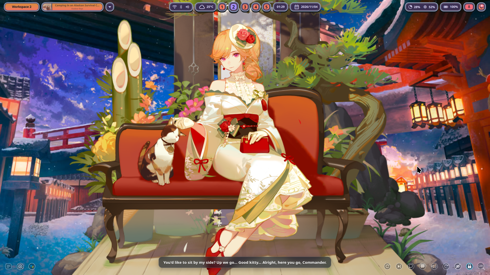

# 💧 mizu-l2d

<div align="center">

**Ultra-low-overhead Live2D (Cubism) wallpaper daemon for Wayland and Niri compositors**  
Seamless interactive character rendering on `wlr-layer-shell` background with multi-monitor WebKit mirroring, zero-overhead idle pausing, and game-accurate interaction parity.

[](https://github.com/AtelierMizumi/mizu-l2d/actions/workflows/ci.yml)
[](https://github.com/AtelierMizumi/mizu-l2d/releases)
[](https://ateliermizumi.github.io/mizu-l2d/)
[](https://opensource.org/licenses/MIT)
[](SPECIFICATION.md)

🌐 **Live Web Showcase & Simulator:** [https://ateliermizumi.github.io/mizu-l2d/](https://ateliermizumi.github.io/mizu-l2d/)  
📖 **Developer Specification:** [SPECIFICATION.md](SPECIFICATION.md) · **Rice Integration:** [Mizumi Dotfiles](https://github.com/AtelierMizumi/dotfiles)

</div>

---

## 📸 Showcase & Demos

<div align="center">

### 🎬 Real-time 60 FPS Desktop & Live2D Demo (Richelieu)
*Runs on the `wlr-layer-shell` background layer with pointer follow, physics, dialogue, and dynamic theming.*

https://github.com/AtelierMizumi/mizu-l2d/releases/download/v0.2.0-beta/model-preview.mp4

<br/>



</div>

---

## ⚡ Key Highlights

- 🪞 **The Mirror Spike (< 400MB RSS):** Dual-monitor setups run 1 single WebKitWebProcess mirrored via GTK4 `WidgetPaintable`, cutting RAM usage from 970MB down to 342MB.
- 💤 **Configurable Pause-on-Cover (0% GPU):** Monitors `niri msg --json event-stream` to automatically freeze rendering when an application is fullscreen, with full support for acrylic blur & tiling gaps.
- 🎯 **100% Data-Driven Parity:** Complete zero-hardcode interaction engine covering all 16 trigger types, gesture drags, parameter relations (101-104), and state machines.
- 🎨 **Desktop Theme Synchronization:** Pairs with [Mizumi Dotfiles](https://github.com/AtelierMizumi/dotfiles) to extract Material-3 theme tokens and niri focus rings directly from character textures.
- 🔌 **Dynamic Monitor Hotplug:** Seamlessly adapts to external HDMI connect/disconnect with automatic primary source promotion.

---

## 🚀 Quickstart

### 1. Installation (Arch Linux)
```sh
# Install runtime dependencies
sudo pacman -S --needed gtk4 gtk4-layer-shell webkitgtk-6.0 python-gobject

# Clone and vendor web dependencies (MIT)
git clone https://github.com/AtelierMizumi/mizu-l2d ~/Projects/Tools/mizu-l2d
cd ~/Projects/Tools/mizu-l2d
./scripts/fetch-web-deps.sh
```

*(Note: Live2D Cubism Core is proprietary. Symlink your local copy to `web/vendor/live2dcubismcore.min.js` per [Licensing](#licensing)).*

### 2. Run Standalone or as Systemd Service
```sh
# Run standalone daemon
python3 wall/mizu-l2d-wall.py

# Or enable as systemd user unit (managed by shell)
systemctl --user enable --now mizu-l2d-wall
```

### 3. Command Line Control (CLI)
```sh
# Inspect daemon status and memory telemetry
python3 wall/mizu-l2d-ctl.py status

# Switch character model
python3 wall/mizu-l2d-ctl.py model gaoxiong_7

# Adjust camera zoom and placement
python3 wall/mizu-l2d-ctl.py camera zoom 1.2
```

---

## 📚 Technical Specifications

For full architectural blueprints, IPC socket command formats, interaction trigger specifications, and model cache management protocols, refer to:

👉 **[Complete Developer Specification (`SPECIFICATION.md`)](SPECIFICATION.md)**

---

## 📄 Licensing & Content Policy

- **Code in this repo:** MIT — see [LICENSE](LICENSE).
- **Vendored Web Bundles:** `pixi.js` and `pixi-live2d-display` are MIT (see `web/vendor/SOURCES.md`).
- **Live2D Cubism Core:** Proprietary to Live2D Inc. Never committed.
- **Character Content:** Models and dialogue are third-party IP (e.g. Manjuu/Yostar). Excluded from this repository for personal local use only.
