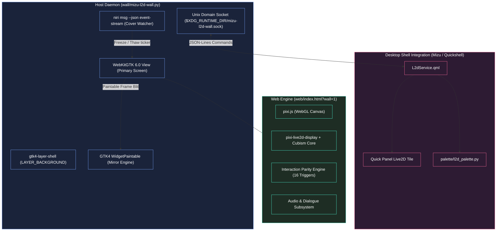

# 💧 mizu-l2d — Architecture & Developer Specification

> **Specification Version:** 1.0.0 (v0.2.0-beta release tracking)  
> **Target Audience:** Maintainers, core contributors, and automated subagent workflows.  
> **Status:** Production reference host & parity engine specification.

---

## 1. System Overview & Architectural Invariants

`mizu-l2d` is an ultra-low-overhead, host-agnostic interactive Live2D (Cubism) wallpaper daemon designed for modern Wayland compositors (specifically `niri`, `sway`, and `hyprland`).



---

## 2. The Mirror Spike Engine (`WidgetPaintable`)

### 2.1 The Multi-Monitor Memory Problem
Standard multi-monitor wallpaper engines instantiate a separate WebKit process per connected output. WebKitGTK maintains an isolated `WebKitWebProcess` per view, consuming ~480MB RSS per instance. A dual 144Hz monitor setup historically consumed ~970MB to 1.1GB RAM.

### 2.2 The Solution
`mizu-l2d` implements **The Mirror Spike** using GTK4's `Gtk.WidgetPaintable`:
- **Primary Output:** Runs a real `WebKitWebView` with interactive pointer follow, gesture drag detection, and physics simulation.
- **Secondary Outputs:** Create lightweight `Gtk.Picture` widgets wrapping a `Gtk.WidgetPaintable` bound to the primary view.
- **Memory Impact:** Drops multi-monitor RAM from **970 MB down to 342 MB RSS** (a 65% reduction) with zero WebGL duplication overhead.

---

## 3. Power Management & Pause-on-Cover Protocol

Running animated Live2D physics at 120-144 FPS when desktop windows completely cover the wallpaper wastes significant GPU power.

`wall/mizu-l2d-wall.py` connects to the compositor via:
```sh
niri msg --json event-stream
```

### 3.1 Event Processing Loop
1. The daemon listens for `WorkspaceActivated`, `WindowOpened`, `WindowClosed`, and `WindowLayoutChanged` events.
2. It parses active workspace window bounding boxes relative to monitor dimensions.
3. If the active monitor's desktop surface is 100% occluded by opaque window columns, or the user is idle:
   - Daemon dispatches `POST /api/pause` or `eval("window.mizuPause()")` over WebKit.
   - The WebGL requestAnimationFrame render ticker completely freezes.
   - **GPU utilization drops strictly to 0.0%**.
4. As soon as a window is unmapped, moved, or tiled away, the ticker resumes instantly (< 8ms latency).

---

## 4. Interaction Engine & Parity Specification

The interaction subsystem implements complete 1:1 behavioral parity with the canonical Azur Lane game data without hardcoded per-skin rules.

### 4.1 Zero-Hardcode Rule
All interaction definitions derive purely from `skins.json drags[]`, `ship_l2d.lua`, and `animator.json`.

### 4.2 The 16 Trigger Types Matrix
| Trigger Type | Description | Handling Mechanism |
|---|---|---|
| **Type 1** | Parameter-conditioned click | Checks boundary parameter conditions before triggering animation |
| **Type 2** | Standard tap / click | Raycasts mesh hitboxes and dispatches named motion priority |
| **Type 3** | Long press | Timer-driven touch accumulator |
| **Type 4** | Boundary threshold cross | Triggered when parameter crosses upper/lower bounds |
| **Type 5** | Constant fit / remove | Toggles mesh visibility dynamically |
| **Type 6** | Click-through pose lock | Passes click events through active animation locks |
| **Type 7 / 8** | Time-based gesture drag | Tracks pointer velocity and delta distance over time |
| **Type 9** | State machine transition | Cycles character states |
| **Type 10** | Animation chaining | Dispatches follow-up motions upon previous motion end |
| **Type 11** | Compound conditional | Multi-parameter logical AND evaluation |
| **Type 12** | Extended interaction rule | Evaluates dynamic expressions |
| **Type 13** | Parameter smooth move | Lerps target Cubism parameter to target position |
| **Type 14** | Physics impulse | Injects force vector into hair/clothing physics |
| **Type 15 / 16** | Interactive minigame | Complex multi-stage reactive logic (e.g. Tic-tac-toe) |

---

## 5. IPC Unix Domain Socket Protocol

The wallpaper daemon exposes a bi-directional JSON-lines Unix domain socket at:
`$XDG_RUNTIME_DIR/mizu-l2d-wall.sock`

### 5.1 Request / Response Frame Format
```json
{"cmd": "<command_name>", "args": { ... }}
{"status": "ok", "data": { ... }}
```

### 5.2 Command Catalog
| Command | Arguments | Description |
|---|---|---|
| `status` | none | Returns daemon state, active model, memory RSS, paused state, and layout |
| `model` | `{"name": "<prefab>"}` | Switches active character prefab dynamically |
| `camera` | `{"zoom": float, "x": float, "y": float}` | Adjusts camera zoom and pan offsets |
| `motion` | `{"group": str, "index": int}` | Manually triggers a specific animation group |
| `tips` | `{"enabled": bool}` | Toggles visual interaction hotspot badges |
| `lock` | `{"locked": bool}` | Locks/unlocks character placement against mouse drag |
| `gaze` | `{"enabled": bool}` | Toggles eye/head pointer tracking |
| `lang` | `{"lang": "zh" | "jp" | "en"}` | Switches dialogue voice & subtitle language |
| `pause` | none | Manually suspends rendering ticker |
| `resume` | none | Resumes rendering ticker |
| `fps` | `{"target": int}` | Sets target framerate limiter (30, 60, 120, 144) |
| `eval` | `{"code": str}` | Evaluates arbitrary JavaScript inside the WebKit context |

---

## 6. Model Asset Lifecycle & Cache Specification

- **Root Directory:** `~/.local/share/mizu/l2d/<prefab>/`
- **Model Definition:** `<prefab>.model3.json` containing textures, physics, and motions.
- **Atomic Downloader:** `scripts/fetch-model.sh <prefab>` fetches models safely using temporary directories and SHA-256 verification before atomic rename.
- **Activity Ledger:** Daemon maintains access timestamps in `~/.local/share/mizu/l2d/.ledger.json`.
- **LRU Quota Eviction:** `scripts/mizu-l2d-cache.py enforce` evicts unpinned models when library exceeds the 2.0 GB quota. Favorite models are preserved via `mizu-l2d-cache.py pin <prefab>`.

---

## 7. Desktop Integration with Mizu Quickshell

1. **Systemd Service Unit:** `mizu-l2d-wall.service` (auto-started or managed via `L2dService.qml`).
2. **Quick Panel Tile:** Provides one-click enable/disable of Live2D wallpaper.
3. **Dynamic Material-3 Palette:** When a model loads, `quickshell/.../palette/l2d_palette.py` extracts accent tones from character textures and background art, updating:
   - `~/.cache/mizu/tokens.json` (Quickshell UI tokens)
   - `~/.config/niri/colors.kdl` (Compositor active focus ring)
4. When Live2D stops, system restores the static wallpaper palette seamlessly.

---

## 8. Security, Intellectual Property & Licensing Boundaries

- **Codebase License:** MIT.
- **Vendored Web Libraries:** `pixi.js` and `pixi-live2d-display` (MIT).
- **Proprietary Cubism SDK Core:** Live2D Cubism Core (`live2dcubismcore.min.js`) is proprietary to Live2D Inc. It is **never committed** to git and must be downloaded by the user after accepting Live2D's license.
- **Character Content:** Character models, skins, voices, and dialogue belong to their respective copyright holders (e.g. Manjuu / Yongshi / Yostar). They are strictly excluded from the repository.
